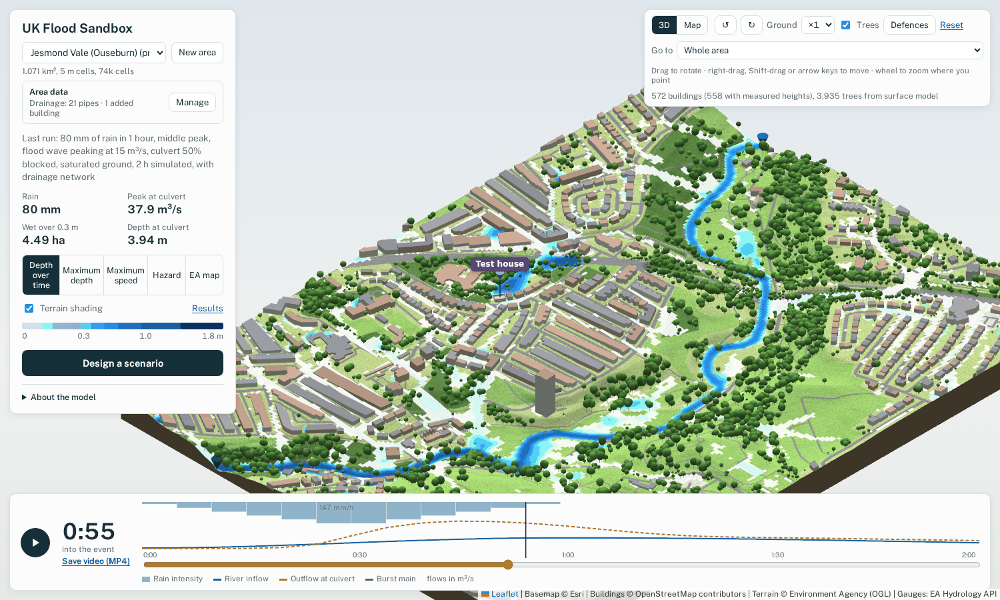
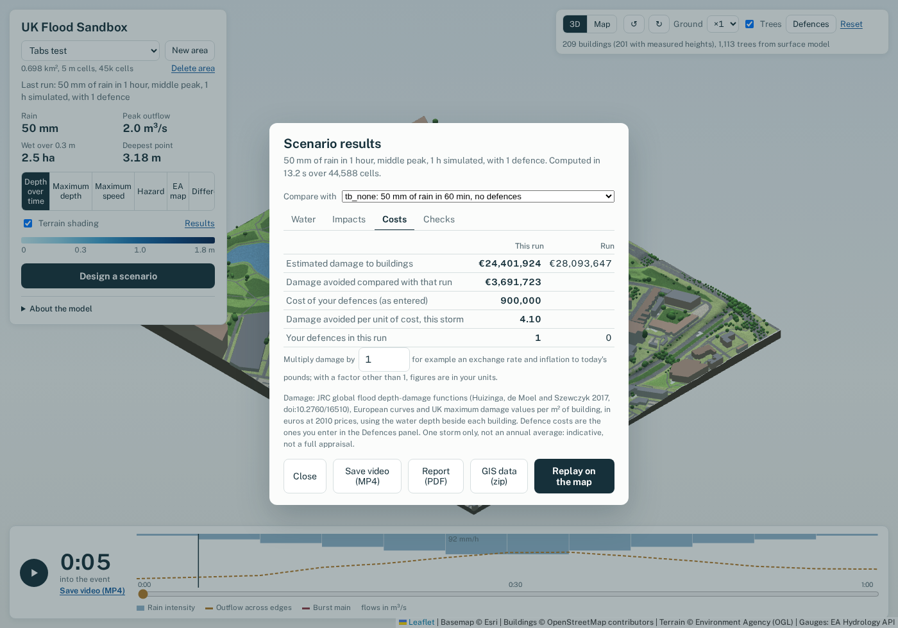

# UK Flood Sandbox

Draw an area almost anywhere in England, Wales, Scotland or Northern Ireland, design a flood scenario (rain,
rivers, tides and storm surges, a burst water main, a blocked culvert) and run it with a two-dimensional surface
water model on your own computer. Watch the water in 3D, add flood defences and sustainable drainage, and compare
the results: depths, hazard to people, buildings, roads and key sites affected, and indicative damage.

> **Important.** Results are indicative and come from a simplified model (no sewer network unless you import
> one; many river beds are
> assumed). Use them to explore scenarios, teach and compare options, **not** to judge the flood risk of a
> particular property or to support planning decisions. For official flood risk information see the national
> flood maps of the Environment Agency, Natural Resources Wales, SEPA and DfI Rivers.

## What it does

- **Anywhere in the UK**: terrain from national LiDAR (Environment Agency, Welsh Government, Scottish Remote
  Sensing Portal, DfI and OSNI), buildings, roads and land cover from OpenStreetMap, prepared automatically.
- **Floods from rain, rivers and the sea**: designed or recorded storms, river flood waves, burst mains, and
  26 tidal estuaries driven by recorded or synthetic tides, with gauged river flows where available.
- **Mitigation**: draw walls, embankments, demountable barriers, storage basins, raised kerbs, channel
  deepening, permeable surfaces, rain gardens, swales, tree planting, green roofs, storage tanks, pumps and
  timed flood gates, then compare against the same storm without them.
- **Results**: depth over time, maximum depth and speed, hazard to people (Defra/EA method), buildings, roads and
  key sites affected, indicative damage (JRC depth-damage functions), a comparison with the EA national
  surface-water map, and a "difference" view between runs.
- **Outputs**: a one-page PDF report, MP4 videos, GeoTIFF and GeoPackage layers, and the full time series as
  CF NetCDF, for QGIS, ArcGIS or Python.

## Getting started

Requirements: Windows, macOS or Linux; Python 3.10 to 3.13 (not 3.14 yet); an internet connection for the
data downloads.

1. Download or clone this repository.
2. Run `start_windows.bat` (Windows) or `./start_mac_linux.sh` (macOS, Linux). The first start creates a Python
   environment and installs the dependencies, which takes a few minutes.
3. Your browser opens at http://localhost:8765. The Jesmond Vale (Newcastle) preset is ready to run; use
   **New area** to draw your own.

The app runs a local web server that only accepts connections from your own computer. On first start it
measures your computer's speed in the background (about a minute) to size its run-time estimates.

**Optional: river flows in Wales.** Recorded runs on Welsh estuaries can use Natural Resources Wales river
levels. Get a free key at https://api-portal.naturalresources.wales/, copy `settings.example.json` to
`settings.json` and add the key. Keep it private: `settings.json` is excluded from the repository.

## How it works, briefly

The surface is a regular grid of 5 or 10 m cells split into triangles, solved by the OpenSWMM 6 two-dimensional
engine. Estuaries are one-dimensional SWMM models from the tidal limit to a tide gauge, whose levels drive the
area's river boundaries. Defences and drainage measures are built into each run's copy of the mesh, or added as
linked one-dimensional elements (tanks, pumps, gates). Every run checks its water balance.
Details, assumptions and test results: [docs/technical-notes.md](docs/technical-notes.md).

## Main limitations

- No sewer or drainage network unless you import one (see [Drainage networks](docs/technical-notes.md#drainage-networks));
  roofs drain to the ground beside each building. Without a network, small, frequent storms flood more than they
  would in reality.
- River beds of most estuaries are assumed; four (Thames, Humber, Severn, Exe) are calibrated against tide gauges.
  Several estuaries use a tide gauge some distance away.
- Flood defence data is incomplete in places, and absent in Scotland and Northern Ireland.
- The engine is an alpha release (OpenSWMM 6.0.0a4), pinned in `requirements.txt`.

## Documentation

- [Technical notes](docs/technical-notes.md): methods, data sources, assumptions and tests in detail.
- [Validation so far](docs/validation.md): what has been checked and what has not.
- [Third-party data and software](NOTICE): licences and attribution.
- [AI usage](AI_USAGE.md): how generative AI was used in developing the software.

## Citing

If you use the software, please cite it as described in [CITATION.cff](CITATION.cff).

## Contributing

Bug reports, questions and contributions are welcome: see [CONTRIBUTING.md](CONTRIBUTING.md) and the
[code of conduct](CODE_OF_CONDUCT.md).

## Licence and acknowledgements

The code is released under the Apache License 2.0 ([LICENSE](LICENSE)). Data used by the app remains under its
providers' licences; see [NOTICE](NOTICE). The two-dimensional model is the OpenSWMM 6 engine (HydroCouple,
Apache-2.0). Contains public sector information licensed under the Open Government Licence v3.0. Map data
(c) OpenStreetMap contributors.
