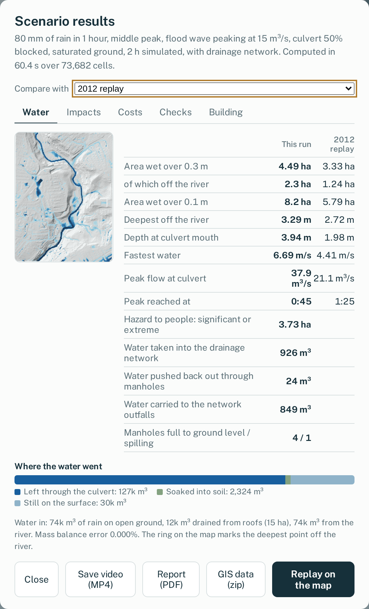
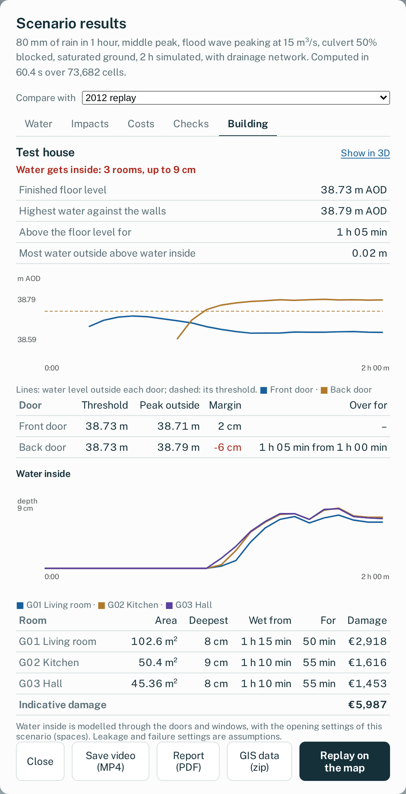
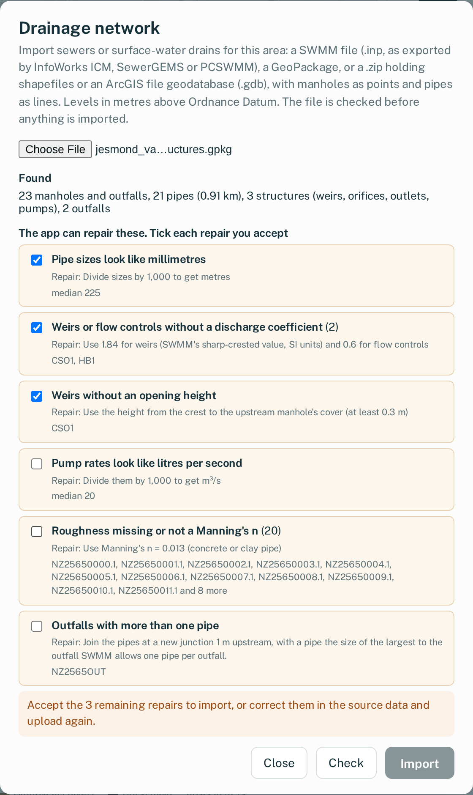

# UK Flood Sandbox

Draw an area almost anywhere in England, Wales, Scotland or Northern Ireland, design a flood scenario (rain,
rivers, tides and storm surges, a burst water main, a blocked culvert) and run it with a two-dimensional surface
water model on your own computer. Watch the water in 3D, add flood defences and sustainable drainage, bring in
your own drainage network or buildings (IFC models, laser or drone point clouds, phone scans), and compare the
results: depths, hazard to people, buildings, roads and key sites affected, water getting into buildings, and
indicative damage.

> **Important.** Results are indicative and come from a simplified model: no sewer network unless you import one,
> many river beds are assumed, and how water gets into buildings rests on published but limited evidence. Use them
> to explore scenarios, teach and compare options, **not** to judge the flood risk of a particular property or to
> support planning decisions. For official flood risk information see the national flood maps of the Environment
> Agency, Natural Resources Wales, SEPA and DfI Rivers.

## What it does

- **Anywhere in the UK**: terrain from national LiDAR (Environment Agency, Welsh Government, Scottish Remote
  Sensing Portal, DfI and OSNI), buildings, roads and land cover from OpenStreetMap, rivers and flood defences,
  prepared automatically in a few minutes.
- **Floods from rain, rivers and the sea**: designed or recorded storms (including the pattern of Newcastle's
  June 2012 storm), river flood waves of up to 3,000 m³/s entering across the channel's width, burst mains, and
  26 tidal estuaries driven by recorded or synthetic tides, with gauged river flows where available.
- **Mitigation**: draw walls, embankments, demountable barriers, storage basins, raised kerbs, channel
  deepening, permeable surfaces, rain gardens, swales, tree planting, green roofs, storage tanks, pumps and
  timed flood gates, then compare against the same storm without them.
- **Drainage networks**: import sewers or drains from a SWMM file (InfoWorks ICM, SewerGEMS, PCSWMM) or GIS
  layers (GeoPackage, shapefiles, ArcGIS file geodatabase), including weirs, flow controls, pumps and storage.
  Every file is checked first: problems that must be fixed at source stop the import, and any repair the app
  offers needs your consent. Manholes are coupled to the surface through gullies and covers (solid, grated or
  sealed), and results show what the network took in, spilled and carried away.
- **Your own buildings**: add a building from an IFC model, a point cloud (LAS, LAZ, E57, XYZ, PTS, CSV) or a
  mesh from a phone scan or photogrammetry (OBJ, PLY, GLB, glTF), or click a building on the map to replace it.
  Georeferenced files land in place; others are dragged and rotated on the map, and phone scans are levelled on
  the LiDAR. Doors and windows come from the IFC model, or are marked by clicking the scan in 3D.
- **Water getting into buildings**: room by room (or per storey for scans), through outside doors that leak at
  rates measured in laboratory tests of UK doors, open doors, doors that give way, breaking windows and door
  barriers, spreading through internal doors and draining out again. Each building gets a report: water at each
  door against its threshold, depth in each room over time, indicative damage, and a warning when the water
  outside rises high enough above the water inside for cavity walls to be at risk.
- **Results**: depth over time, maximum depth and speed, hazard to people (Defra/EA method), buildings, roads and
  key sites affected, indicative damage (JRC depth-damage functions), a comparison with the EA national
  surface-water map, and a "difference" view between runs.
- **Outputs**: a one-page PDF report, MP4 videos, GeoTIFF and GeoPackage layers, and the full time series as
  CF NetCDF, for QGIS, ArcGIS or Python.

  
  
  

*Left to right: a run's results, the report for an added building (water at each door and inside each room), and
the check of an imported drainage network (repairs need your consent).*

## Getting started

Requirements: Windows, macOS or Linux; Python 3.10 to 3.13 (not 3.14 yet); an internet connection for the
data downloads.

1. Download or clone this repository.
2. Run `start_windows.bat` (Windows) or `./start_mac_linux.sh` (macOS, Linux). The first start creates a Python
   environment and installs the dependencies, which takes a few minutes.
3. Your browser opens at http://localhost:8765. The Jesmond Vale (Newcastle) preset is ready to run; use
   **New area** to draw your own.

The app runs a local web server that only accepts connections from your own computer. On first start it
measures your computer's speed in the background (about a minute) to size its run-time estimates.

**Updating.** After pulling a new version, run the start script again: it installs any new dependencies once.

**Using the app.**

- **Design a scenario** sets the storm, rivers, tide, burst main, culvert, ground condition, drainage network
  and how added buildings' doors and windows behave; the run takes a few minutes for about 1 km².
- **Area data** in the side panel (Manage) holds the drainage network and added buildings for the area: import,
  replace, show or remove them, and mark doors and windows on scans.
- **3D view**: drag to rotate; right-drag, Shift-drag or the arrow keys to move; the mouse wheel zooms where you
  point. Added buildings carry a labelled pin, and **Go to** jumps to one.
- **Results** lists everything a run measured, with a **Building** tab for each added building.

**Optional: river flows in Wales.** Recorded runs on Welsh estuaries can use Natural Resources Wales river
levels. Get a free key at https://api-portal.naturalresources.wales/, copy `settings.example.json` to
`settings.json` and add the key.

## How it works, briefly

The surface is a regular grid of 5 or 10 m cells split into triangles, solved by the OpenSWMM 6 two-dimensional
engine. Estuaries are one-dimensional SWMM models from the tidal limit to a tide gauge, whose levels drive the
area's river boundaries. Defences and drainage measures are built into each run's copy of the mesh, or added as
linked one-dimensional elements (tanks, pumps, gates). Imported drainage networks and the insides of added
buildings are one-dimensional too, linked to the surface cells they sit on. Every run checks its water balance.
Details, assumptions, sources and test results: [docs/technical-notes.md](docs/technical-notes.md).

## Main limitations

- No sewer or drainage network unless you import one (see [Drainage networks](docs/technical-notes.md#drainage-networks));
  roofs drain to the ground beside each building. Without a network, small, frequent storms flood more than they
  would in reality. Imported networks start empty (no foul or dry-weather flow), and gully capacities, cover
  openings and chamber sizes are assumptions unless the data gives them.
- Water entering buildings rests on limited evidence: door leakage, window behaviour, and wall failure based on an analysis of modern English homes (see the technical notes for
  the sources). Airbricks and stairs are not modelled.
- Phone scans have no real heights: they are levelled on the LiDAR, so their levels are only as accurate as it is.
  Unclassified scans may include trees or walls touching the building.
- River beds of most estuaries are assumed; except four (Thames, Humber, Severn, Exe) that are calibrated against tide gauges.
  Several estuaries use a tide gauge some distance away.
- Flood defence data is incomplete in places (England and Wales) and absent in Scotland and Northern Ireland.
- Import of drainage, IFC and scan files may raise cases the checks don't yet cover. Reports of these are very welcome.
- The engine is an alpha release (OpenSWMM 6.0.0a4), pinned in `requirements.txt`.

## Documentation

- [Technical notes](docs/technical-notes.md): methods, data sources, assumptions and tests in detail.
- [Validation so far](docs/validation.md): what has been checked and what has not.
- [Third-party data and software](NOTICE): licences and attribution.
- [AI usage](AI_USAGE.md): how generative AI was used in developing the software.

## Citing

If you use the software, please cite it as described in [CITATION.cff](CITATION.cff).

## Contributing

Bug reports, questions and contributions are welcome: see [CONTRIBUTING.md](CONTRIBUTING.md) and the
[code of conduct](CODE_OF_CONDUCT.md).

## Licence and acknowledgements

The code is released under the Apache License 2.0 ([LICENSE](LICENSE)). Data used by the app remains under its
providers' licences; see [NOTICE](NOTICE). The two-dimensional model is the OpenSWMM 6 engine (HydroCouple,
Apache-2.0). Contains public sector information licensed under the Open Government Licence v3.0. Map data
(c) OpenStreetMap contributors.
